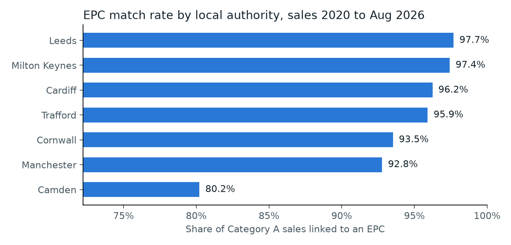
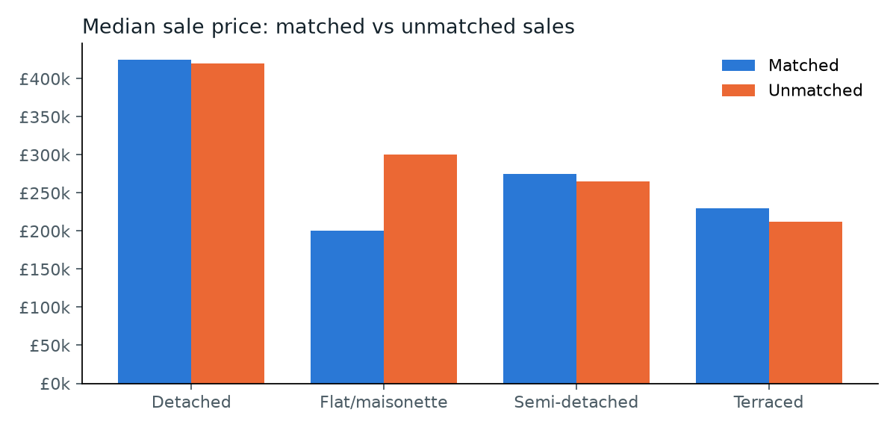

# Match quality: Land Registry sales to EPC certificates

_Generated 14 October 2026 by `python -m valuation_monitor.matching`. Aggregated figures only; no addresses. Data snapshot: decision D-015._

## Headline
- **243,320 of 256,677** Category A sales (2020 to 28 Aug 2026) were linked to an EPC certificate lodged on or before the sale: **94.8%**.
- Property-type consistency check: in **98.8%** of 243,320 links, Land Registry and the EPC agree on whether the home is a flat. This is a proxy for false matches; precision is measured properly in Week 2 on 300 hand-checked pairs.
- The linked certificate was lodged a median of **342 days** before the sale; 51.2% within a year and 1.6% more than ten years earlier. Older certificates may not reflect later extensions or refurbishment.

## Outcome of every sale
| Status | Sales | Share | Meaning |
| --- | ---: | ---: | --- |
| `matched` | 243,320 | 94.8% | Linked to a certificate lodged on or before the sale |
| `no_address_match` | 9,697 | 3.8% | Certificates exist at the postcode, but none for this address |
| `certificates_only_after_sale` | 1,580 | 0.6% | The property's certificates were all lodged after the sale |
| `ambiguous` | 1,351 | 0.5% | Two or more properties tied at the best rule, so left unmatched |
| `no_epc_at_postcode` | 690 | 0.3% | No certificate at all at the sale's postcode |
| `no_postcode` | 39 | 0.0% | The sale has no postcode |

## Matched sales by rule tier
| Tier | Rule | Sales | Share of matched | Type consistency |
| --- | --- | ---: | ---: | ---: |
| 1 | Exact address | 142,622 | 58.6% | 98.8% |
| 2 | Same house/flat numbers and street | 95,841 | 39.4% | 98.8% |
| 3 | Named house, similar name | 1,576 | 0.6% | 99.2% |
| 4 | Named house, certificate adds the hamlet | 3,281 | 1.3% | 99.7% |

## Is the matched set biased?
- **Lowest match rate: Camden (80.2%)**, against 94.8% overall. Flats match least often (87.4%).
- **Unmatched flats are worth more:** median £300,000 against £200,000 for matched flats. The model will therefore see fewer high-value flats than the market contains, so its accuracy on them must be reported separately rather than assumed.
- For houses the matched and unmatched medians are close, so exclusion bias there is small.

| Local authority | Sales | Match rate |
| --- | ---: | ---: |
| Camden | 13,136 | 80.2% |
| Manchester | 34,958 | 92.8% |
| Cornwall | 60,588 | 93.5% |
| Trafford | 21,812 | 95.9% |
| Cardiff | 30,512 | 96.2% |
| Milton Keynes | 27,030 | 97.4% |
| Leeds | 68,641 | 97.7% |

| Property type | Sales | Match rate |
| --- | ---: | ---: |
| Detached | 54,637 | 95.2% |
| Flat/maisonette | 57,273 | 87.4% |
| Semi-detached | 74,253 | 97.8% |
| Terraced | 70,514 | 97.4% |

| New build | Sales | Match rate |
| --- | ---: | ---: |
| No | 229,462 | 95.4% |
| Yes | 27,215 | 89.7% |

| Tenure | Sales | Match rate |
| --- | ---: | ---: |
| Freehold | 186,277 | 96.9% |
| Leasehold | 70,400 | 89.2% |

| Sale year | Sales | Match rate |
| --- | ---: | ---: |
| 2020 | 37,578 | 95.0% |
| 2021 | 51,189 | 93.8% |
| 2022 | 43,035 | 94.0% |
| 2023 | 34,521 | 94.1% |
| 2024 | 36,917 | 95.7% |
| 2025 | 37,324 | 95.8% |
| 2026 | 16,113 | 96.7% |

| Property type | Median price, matched | Median price, unmatched | Unmatched |
| --- | ---: | ---: | ---: |
| Detached | £425,000 | £420,000 | 2,625 |
| Flat/maisonette | £200,000 | £300,000 | 7,241 |
| Semi-detached | £275,000 | £265,000 | 1,667 |
| Terraced | £230,000 | £212,000 | 1,824 |

## Other data checks
- Land Registry's district field agrees with the ONS postcode lookup for 100.0% of study-area sales; 1,063 sales have no postcode in the lookup (most have no postcode at all).
- Price Paid categories in the study area: A = 256,677, B = 59,471. Only Category A is modelled (decision D-002).
- Revisions in the latest monthly update for the study area: A = 4,224, C = 211, D = 83 (A added, C changed, D deleted).

## Limitations and next steps
- Thresholds (Jaro-Winkler 0.85 and 0.92) and tier 4 are first choices. Week 2 measures precision and recall on 300 hand-checked pairs and compares the rules with Splink.
- Ambiguous ties are left unmatched on purpose: a wrong certificate would give the model wrong floor areas, which is worse than a missing one.
- Unmatched sales are excluded from modelling. The tables above show where that exclusion falls, so its effect on the results can be discussed.
