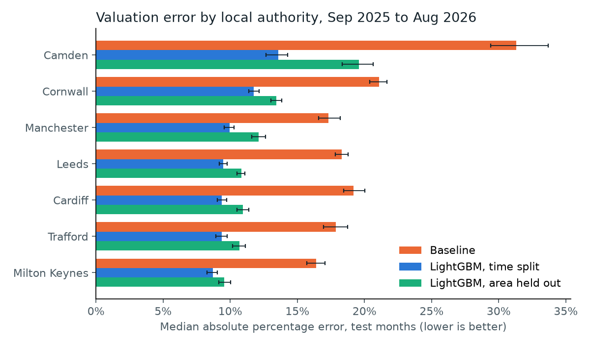
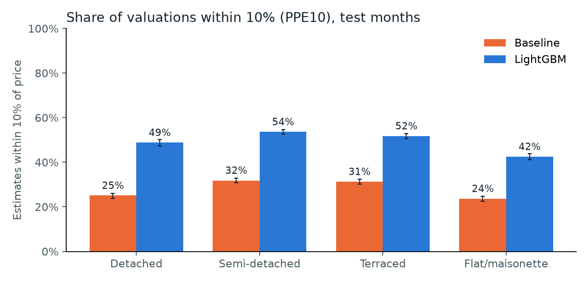

# Model performance: baseline against LightGBM and CatBoost

_Generated 17 October 2026 by `py -3.12 -m valuation_monitor.modelling`. Aggregated figures only; no addresses. Periods: decision D-020; metrics: D-021; intervals: percentile bootstrap over sales, 1,000 resamples._

## Headline
- **Test period (Sep 2025 to Aug 2026, 27,639 matched sales never used in training):** LightGBM has a median absolute error of **10.0%** against **19.0%** for the HPI-indexed district median. It values **50.0%** of homes within 10% of the price, against 28.7%.
- **Unseen areas:** trained on six local authorities and tested on the seventh, LightGBM reaches a pooled MdAPE of **11.6%** (baseline 19.0%).
- **Model choice:** LightGBM is taken forward to the conformal ranges in Week 3 because it had the lower MdAPE on the calibration period (CatBoost 9.92%, LightGBM 9.83%). The test period played no part in the choice.

## Time split: test period
Point estimate with 95% confidence interval. MdAPE: lower is better. PPE10 and PPE20: higher is better. Bias: median percentage error, where positive means over-valuation.

| Estimator | MdAPE | PPE10 | PPE20 | Bias |
| --- | ---: | ---: | ---: | ---: |
| Baseline | 19.0% (18.7% to 19.3%) | 28.7% (28.2% to 29.3%) | 52.0% (51.4% to 52.5%) | 0.2% (-0.2% to 0.6%) |
| LightGBM | 10.0% (9.9% to 10.2%) | 50.0% (49.3% to 50.5%) | 77.9% (77.5% to 78.5%) | 0.0% (-0.2% to 0.2%) |
| CatBoost | 10.2% (10.0% to 10.3%) | 49.4% (48.8% to 50.0%) | 77.6% (77.1% to 78.1%) | -0.4% (-0.6% to -0.2%) |

Paired difference from the baseline (same bootstrap resamples):

| Model | MdAPE change | PPE10 change | PPE20 change | Bias change |
| --- | ---: | ---: | ---: | ---: |
| LightGBM | −9.0 pts (-9.3 to -8.7) | +21.2 pts (+20.5 to +22.0) | +26.0 pts (+25.3 to +26.7) | −0.2 pts (-0.6 to +0.2) |
| CatBoost | −8.8 pts (-9.1 to -8.5) | +20.7 pts (+20.0 to +21.4) | +25.7 pts (+25.0 to +26.4) | −0.6 pts (-1.1 to -0.3) |

## By local authority (time split, test period)
|  | Test sales | Baseline MdAPE | LightGBM MdAPE | Baseline PPE10 | LightGBM PPE10 |
| --- | ---: | ---: | ---: | ---: | ---: |
| Camden | 1,116 | 31.3% (29.4% to 33.7%) | 13.6% (12.7% to 14.3%) | 16.9% (14.7% to 19.3%) | 38.7% (35.6% to 41.6%) |
| Cardiff | 3,498 | 19.2% (18.4% to 20.0%) | 9.4% (9.0% to 9.7%) | 28.8% (27.4% to 30.3%) | 52.7% (51.1% to 54.2%) |
| Cornwall | 6,508 | 21.1% (20.4% to 21.7%) | 11.8% (11.4% to 12.1%) | 26.0% (24.9% to 27.0%) | 43.9% (42.7% to 45.1%) |
| Leeds | 7,782 | 18.3% (17.8% to 18.8%) | 9.5% (9.2% to 9.8%) | 30.6% (29.6% to 31.7%) | 52.2% (51.1% to 53.4%) |
| Manchester | 3,583 | 17.3% (16.6% to 18.2%) | 9.9% (9.5% to 10.3%) | 30.8% (29.3% to 32.2%) | 50.2% (48.5% to 51.7%) |
| Milton Keynes | 2,760 | 16.4% (15.7% to 17.1%) | 8.7% (8.3% to 9.0%) | 31.5% (29.7% to 33.3%) | 55.9% (54.1% to 58.1%) |
| Trafford | 2,392 | 17.9% (16.9% to 18.7%) | 9.4% (8.9% to 9.8%) | 28.9% (27.1% to 30.7%) | 52.9% (50.9% to 54.8%) |

## By property type (time split, test period)
|  | Test sales | Baseline MdAPE | LightGBM MdAPE | Baseline PPE10 | LightGBM PPE10 |
| --- | ---: | ---: | ---: | ---: | ---: |
| Detached | 5,699 | 21.8% (21.1% to 22.6%) | 10.4% (10.0% to 10.7%) | 25.0% (23.9% to 26.1%) | 48.8% (47.4% to 50.1%) |
| Flat/maisonette | 5,202 | 23.8% (23.0% to 24.6%) | 12.1% (11.7% to 12.5%) | 23.6% (22.5% to 24.7%) | 42.5% (41.1% to 43.8%) |
| Semi-detached | 8,459 | 16.8% (16.4% to 17.4%) | 9.1% (8.8% to 9.4%) | 31.8% (30.8% to 32.8%) | 53.6% (52.5% to 54.7%) |
| Terraced | 8,279 | 17.4% (17.0% to 17.9%) | 9.6% (9.4% to 9.8%) | 31.3% (30.3% to 32.3%) | 51.7% (50.7% to 52.8%) |

## Local-authority holdout: does it work in an area it has never seen?
Each row: models trained on the other six local authorities (training period), tested on this one (test period). The baseline needs no training, so it is the same as in the time split. MdAPE with 95% confidence interval.

| Held-out area | Test sales | Baseline | LightGBM | CatBoost | LightGBM: change from time split |
| --- | ---: | ---: | ---: | ---: | ---: |
| Camden | 1,116 | 31.3% (29.4% to 33.7%) | 19.6% (18.3% to 20.7%) | 19.7% (18.7% to 21.5%) | +6.0 pts |
| Cardiff | 3,498 | 19.2% (18.4% to 20.0%) | 11.0% (10.5% to 11.4%) | 11.3% (10.7% to 11.8%) | +1.6 pts |
| Cornwall | 6,508 | 21.1% (20.4% to 21.7%) | 13.4% (13.0% to 13.8%) | 13.3% (12.9% to 13.7%) | +1.7 pts |
| Leeds | 7,782 | 18.3% (17.8% to 18.8%) | 10.8% (10.5% to 11.1%) | 10.6% (10.2% to 10.8%) | +1.4 pts |
| Manchester | 3,583 | 17.3% (16.6% to 18.2%) | 12.1% (11.6% to 12.6%) | 11.8% (11.2% to 12.2%) | +2.2 pts |
| Milton Keynes | 2,760 | 16.4% (15.7% to 17.1%) | 9.6% (9.1% to 10.0%) | 9.7% (9.2% to 10.2%) | +0.9 pts |
| Trafford | 2,392 | 17.9% (16.9% to 18.7%) | 10.7% (10.2% to 11.1%) | 10.7% (10.3% to 11.2%) | +1.3 pts |
| **All areas pooled** | 27,639 | 19.0% (18.7% to 19.2%) | 11.6% (11.4% to 11.8%) | 11.6% (11.4% to 11.7%) |  |

## Method notes and limitations
- **What is modelled:** matched Category A sales only. Unmatched sales, which include more high-value flats (see `match_quality.md`), are excluded, so accuracy on them is unknown.
- **Information cut-off (decision D-022):** every feature, and the baseline, uses only sales completed and HPI months published before the first day of the month three months ahead of the sale. Tests in `tests/test_features.py` check this.
- **Target (decision D-022):** the models predict ln(price ÷ baseline), so the estimate is the baseline × the predicted ratio. The models refine the baseline rather than replace it.
- **Area held out:** the local-authority code is not a feature. In the holdout, the held-out area's own public sales history still feeds its local price features, as it would in practice; only its sales are absent from model training.
- **Tuning:** hyperparameters are sensible defaults with early stopping on the last three training months, not a tuned search. The comparison is therefore conservative for the models.
- **Truth:** the sale price is treated as the true value. Some sales are not at market value even within Category A.
